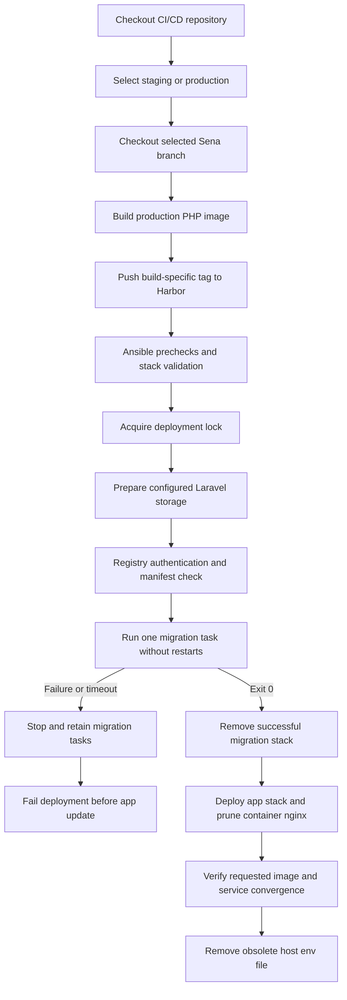

# Sena Core API CI/CD

Jenkins builds the application repository's production image, pushes an immutable build tag to Harbor, and deploys it to Docker Swarm through Ansible. One migration task must finish with exit code zero before the application service is updated.

Jenkins selects the application branch: `staging` deploys staging and `master` deploys production. Deployment runs automatically after a successful image build and push. The verification tests under `tests/` remain local and are not Jenkins stages.

## Deployment flow



Images use `imageregistry.gen-itech.com/senacoreapi/coreapi:TAG`. A Jenkins tag combines environment, build number, and application revision, for example `staging-42-abc123def456`. Migration and app deployment use the same image and tag. The pipeline does not publish shared `latest` aliases, and deployment rejects `latest`.

The application stack is `sena-app`. Migration uses a separate, uniquely named `sena-app-migration-*` stack. Ansible owns the migration ordering and waits for a verified exit code `0` before updating the app. Successful migration stacks are removed; failed migrations are retained for review.

## Environments and configuration

| Setting | Staging | Production |
| --- | --- | --- |
| Application branch | `staging` | `master` |
| Inventory | `ansible/inventory/staging.ini` | `ansible/inventory/production.ini` |
| Group variables | `ansible/group_vars/staging.yml` | `ansible/group_vars/production.yml` |
| Manager address | `172.17.0.206` | Existing `172.17.0.239` entry must be verified |
| Published FastCGI port | `9000` | `9000` |
| Deployment directory | `/opt/core-api/deploy` | `/opt/core-api/deploy` |
| Storage backend | NFS volume `sena-staging-storage` | Local bind mount |
| Storage source | `172.17.0.206:/opt/core-api/core-api/storage` | `/opt/core-api/core-api/storage` |

The role targets exactly one manager. Staging app and migration tasks can run on either configured NFS client node. Production retains its local storage bind mount and manager placement constraint. Both environments keep one app replica.

Non-secret runtime properties belong in `ansible/group_vars/<environment>.yml` under `app_environment_overrides`. Shared defaults are in `ansible/roles/app/defaults/main.yml`. The final environment combines defaults, environment overrides, and Jenkins secrets, and sets `APP_ENV` and `APP_DEBUG=false`.

Production intentionally has incomplete endpoint and mail settings. Fill them in, confirm the manager address and SSH user in `ansible/inventory/production.ini`, then set `app_production_inventory_confirmed: true` before deploying production.

## Setup

- Jenkins agent: Git, Docker CLI and a running build daemon, Python 3, Ansible, and registry access. The job uses Pipeline, Git, Credentials Binding, Workspace Cleanup, and Timestamper plugins.
- Deployment target: exactly one active Swarm manager accepting tasks, Docker CLI, Python 3 with `jsondiff` and `PyYAML`, and the existing `sena-overlay-network` Swarm overlay network.
- Staging storage: the manager's configured NFS export, `nfs-common` on both eligible nodes, and `www-data` UID/GID `33:33` matching the application image.
- Configure SSH authentication and non-interactive privilege escalation for the inventory user. The root `ansible.cfg` verifies SSH host keys; provision the manager's verified host key in the agent's `known_hosts`.

Run commands from the repository root. Install the controller collections with:

```sh
ansible-galaxy collection install -r ansible/requirements.yml
```

Configure the Jenkins job as **Pipeline from SCM**, pointing to this repository with script path `Jenkinsfile`. Configure Git host-key verification for both SCM repositories. Jenkins uses the agent's installed Ansible and collections; the role validates manager prerequisites without installing server packages.

## Jenkins credentials

Create the following Jenkins credentials. Replace `<environment>` with `staging` or `production` for each application secret.

| Credential ID | Type | Controller environment variable |
| --- | --- | --- |
| `github-access` | SSH username with private key | Application checkout |
| `harbor` | Username with password | `HARBOR_USER`, `HARBOR_PASSWORD` |
| `sena-<environment>-app-key` | Secret text | `SENA_APP_KEY` |
| `sena-<environment>-db-password` | Secret text | `SENA_DB_PASSWORD` |
| `sena-<environment>-cgw-api-token` | Secret text | `SENA_CGW_API_TOKEN` |
| `sena-<environment>-mail-password` | Secret text | `SENA_MAIL_PASSWORD` |
| `sena-<environment>-google-maps-api-key` | Secret text | `SENA_GOOGLE_MAPS_API_KEY` |

Use the application's existing `APP_KEY` so encrypted application data remains readable. Ansible maps the controller variables to the application's `APP_KEY`, `DB_PASSWORD`, `CGW_API_TOKEN`, `MAIL_PASSWORD`, and `GOOGLE_MAPS_API_KEY`.

Git and Harbor credentials are shared. Deployment SSH uses the inventory user and the Jenkins system user's existing SSH key or agent; the pipeline does not bind a deployment SSH or sudo-password credential. Verify the manager fingerprint through a trusted connection before populating `known_hosts`.

## Runtime secrets

Stack files contain runtime credentials and are written under `/opt/core-api/deploy` with restricted permissions. Secrets are excluded from Ansible output and command-line extra variables.

Application credentials are explicit service environment variables rendered into the stack, rather than a host `.env` file or Docker secret objects. They remain visible to privileged Docker inspection. Stack files are root-owned with mode `0600`; the deployment directory is mode `0700` and separate from the nginx-readable storage path. Temporary Docker credentials and migration configuration are removed on normal completion or handled failure.

## Required application image support

The selected application branch must contain its production Dockerfile, `docker/uploads.ini`, Supervisor configuration, and the updated entrypoint that waits for the database and executes the requested command without running migrations on app startup. The image supplies the PHP extensions and upload limits previously supplied by this repository.

The project Dockerfile's `prod` target includes application code and production Composer dependencies. The image preserves PostgreSQL, GD, Imagick, `intl`, `mbstring`, `exif`, `pcntl`, and the other PHP extensions previously supplied by the CI/CD role. `docker/uploads.ini` supplies the existing upload limits.

The entrypoint waits for the database with a bounded timeout and reads credentials through environment variables. It then executes the service command: Artisan for the migration task, or Supervisor for the app. Migration logic and the `RUN_MIGRATIONS` flag are no longer part of the entrypoint.

Docker probes the PHP-FPM listening socket. Ansible verifies service convergence and the requested image tag. These checks do not verify ingress reachability, Laravel request handling, or the health of each Supervisor worker. The current implementation permits one app replica; scaling also requires a scheduler and worker plan.

## Jenkins deployment

In **Build with Parameters**, select `APP_BRANCH=staging` for staging or `APP_BRANCH=master` for configured production. Jenkins builds and pushes the application image, then deploys the generated build tag.

1. Jenkins checks out the selected application branch and builds the Dockerfile's `prod` target.
2. It pushes the build tag using temporary registry credentials.
3. Ansible validates the environment, manager, network, and both stack templates before deployment changes.
4. It acquires a deployment lock, prepares Laravel storage directories, and creates staging's NFS-backed Docker volume on the manager if absent. Existing manager volumes must match the configured NFS options. It then runs one uniquely named migration task using the same image and storage as the app. The task runs `php artisan migrate --force --no-interaction` with automatic restarts disabled.
5. After migration success, it removes the migration service, deploys the app stack, prunes the retired container nginx service, and waits for the requested build to converge.
6. It removes the obsolete host `.env` file after successful convergence. Temporary registry credentials, migration configuration, and the lock are cleaned up on success or failure.

The old app continues running during migration. Application updates use one replica and stop-first ordering. Supervisor continues managing PHP-FPM, the queue worker, scheduler, and Pulse worker.

## Host nginx, ingress, and storage

The app stack publishes TCP port `9000` through Swarm's default ingress routing mesh to PHP-FPM port `9000`. Host nginx must use FastCGI for backend requests; its former HTTP upstream on port `8081` must be replaced when deploying this stack. Restrict access to the published FastCGI port to trusted nginx hosts.

Adapt these locations inside the host's existing TLS server block, keeping the frontend upstream on port `8082`:

```nginx
location /api/ {
    include /etc/nginx/fastcgi_params;
    fastcgi_pass 127.0.0.1:9000;
    fastcgi_param SCRIPT_FILENAME /var/www/html/public/index.php;
    fastcgi_param SCRIPT_NAME /index.php;
    fastcgi_param DOCUMENT_ROOT /var/www/html/public;
    fastcgi_param HTTP_X_FORWARDED_PROTO $scheme;
    fastcgi_param HTTP_PROXY "";
    fastcgi_buffers 16 16k;
    fastcgi_buffer_size 32k;
}

location ^~ /storage/ {
    alias /opt/core-api/core-api/storage/app/public/;
    autoindex off;
}
```

The FastCGI script path is the path inside the application container. Use a reachable Swarm node address instead of `127.0.0.1` if nginx runs on another host. Keep nginx's `client_max_body_size 150M`; the image preserves `upload_max_filesize=20M` and `post_max_size=150M`.

Staging uses the named Docker volume `sena-staging-storage`, backed by the manager's NFS export at `/opt/core-api/core-api/storage`. Both stack templates declare the same explicit volume name and NFS driver options, so migration and app tasks use the same files across separate stacks. Docker creates the matching volume on a worker when a task is scheduled there. Volume population from the image is disabled with `nocopy: true`.

Existing files stay in their current manager directory; no copy or move is needed. Host nginx on the manager continues reading `/opt/core-api/core-api/storage/app/public/` directly. The shared volume remains mounted at `/var/www/html/storage` inside the application. Production retains its existing bind mount.

Review and validate host nginx changes with `sudo nginx -t` before reloading. This pipeline does not configure or reload host nginx.

## Staging NFS server setup

The manager `172.17.0.206` hosts the storage and NFS server. Both the manager and worker `172.17.0.190` are NFS clients. These commands assume Ubuntu/Debian. Server provisioning is performed separately from application deployment.

On **both nodes**, verify the readable account names map to the application's numeric IDs, then install the NFS client package:

```sh
id www-data
getent group www-data

sudo apt-get update
sudo apt-get install -y nfs-common
```

The user and group must both have ID `33`. NFS checks numeric IDs; matching names alone is insufficient.

On the **manager only**, install the server and prepare the existing storage directory:

```bash
sudo apt-get install -y nfs-kernel-server

sudo mkdir -p /opt/core-api/core-api/storage/{app/public,app/private,logs,framework/cache/data,framework/sessions,framework/views}
sudo chown -R www-data:www-data /opt/core-api/core-api/storage
sudo find /opt/core-api/core-api/storage -type d -exec chmod 2770 {} +
sudo find /opt/core-api/core-api/storage -type f -exec chmod 0660 {} +
```

The setgid directory bit preserves the `www-data` group on newly created entries. Ansible maintains directory ownership and permissions during staging deployment.

On the **manager only**, configure the export for the two node addresses. Create the base `/etc/exports` file as well, even when the export is defined in `exports.d`:

```sh
sudo mkdir -p /etc/exports.d
sudo touch /etc/exports

sudo tee /etc/exports.d/sena-storage.exports >/dev/null <<'EOF'
/opt/core-api/core-api/storage 172.17.0.206(rw,sync,no_subtree_check,root_squash,anonuid=33,anongid=33) 172.17.0.190(rw,sync,no_subtree_check,root_squash,anonuid=33,anongid=33)
EOF

sudo systemctl enable --now nfs-kernel-server
sudo exportfs -rav
sudo exportfs -v
sudo systemctl status nfs-kernel-server --no-pager
```

`root_squash` maps client root requests to the configured anonymous account, here UID/GID `33:33`. Normal `www-data` requests keep their matching IDs. Both node addresses must appear in `exportfs -v`. The NFS server's `active (exited)` status is normal for its systemd startup service.

If UFW is active on the **manager**, allow NFSv4 TCP traffic from both node addresses:

```sh
sudo ufw allow from 172.17.0.190 to 172.17.0.206 port 2049 proto tcp
sudo ufw allow from 172.17.0.206 to 172.17.0.206 port 2049 proto tcp
```

Apply equivalent rules if another firewall is used. Only the manager runs `nfs-kernel-server` and `exportfs`; the worker requires the NFS client package.

The staging settings are in `ansible/group_vars/staging.yml`: `app_storage_backend: nfs`, the server and export path, the shared volume name, and `app_pin_storage_to_manager: false`. Docker uses `nfsvers=4,rw,hard`. Manual Docker volume creation and host `fstab` entries are unnecessary for this deployment path; Ansible and the stack declarations manage the volume. Keep eligible nodes limited to the configured NFS clients.

## Manual Ansible commands

Use the controller's installed `ansible-playbook` and collections. Run from the repository root so `ansible.cfg` is loaded.

Supply credentials through these controller environment variables, or equivalent protected Ansible variables:

| Controller environment variable | Application or role variable |
| --- | --- |
| `HARBOR_USER` | `app_harbor_username` |
| `HARBOR_PASSWORD` | `app_harbor_password` |
| `SENA_APP_KEY` | `app_secret_environment.APP_KEY` |
| `SENA_DB_PASSWORD` | `app_secret_environment.DB_PASSWORD` |
| `SENA_CGW_API_TOKEN` | `app_secret_environment.CGW_API_TOKEN` |
| `SENA_MAIL_PASSWORD` | `app_secret_environment.MAIL_PASSWORD` |
| `SENA_GOOGLE_MAPS_API_KEY` | `app_secret_environment.GOOGLE_MAPS_API_KEY` |

Do not put passwords or API keys in command-line extra vars. The Jenkins helper passes only non-secret image settings; SSH and sudo use the host configuration and inventory. Unattended Jenkins deployment needs passwordless sudo or a root connection. Interactive local deployment can use `--ask-become-pass`.

Syntax and task listing:

```sh
ansible-playbook -i ansible/inventory/staging.ini ansible/deploy-app.yml --syntax-check
ansible-playbook -i ansible/inventory/production.ini ansible/deploy-app.yml --syntax-check
ansible-playbook -i ansible/inventory/staging.ini ansible/deploy-app.yml --list-tasks
```

A manual deployment uses an existing image build tag:

```sh
ansible-playbook -i ansible/inventory/staging.ini ansible/deploy-app.yml \
  -e image_tag=staging-42-abc123def456 --ask-become-pass
```

Use the actual tag from Jenkins/Harbor, not this example. Direct deployment assumes the image has already been built and pushed. Jenkins is the normal build-and-deploy path.

## Registry/image checks without deployment

To verify registry access, run this **Bash** example on the manager. It checks the manifest without pulling image layers or updating services, using an isolated temporary login:

```bash
(
  set -eu
  set +x
  umask 077
  sena_registry_dir=$(mktemp -d)
  trap 'rm -rf "$sena_registry_dir"' EXIT
  export DOCKER_CONFIG="$sena_registry_dir"
  read -r -p 'Harbor username: ' HARBOR_USER
  read -r -s -p 'Harbor password: ' HARBOR_PASSWORD
  printf '\n'
  printf '%s' "$HARBOR_PASSWORD" | docker login imageregistry.gen-itech.com \
    --username "$HARBOR_USER" --password-stdin
  read -r -p 'Build image tag: ' SENA_REGISTRY_TAG
  docker manifest inspect "imageregistry.gen-itech.com/senacoreapi/coreapi:$SENA_REGISTRY_TAG" > /dev/null
)
```

The temporary CLI credential directory is removed on exit. Swarm nodes need registry connectivity and the authentication forwarded by Ansible. A manifest check does not prove database or application readiness.

## Inspect the deployed stack

Run Swarm administration commands on the selected manager. On staging:

```sh
ssh ansible_deployer@172.17.0.206

docker node ls
docker network inspect sena-overlay-network --format '{{.Driver}} / {{.Scope}}'
docker stack ls
docker stack services sena-app
docker stack ps --no-trunc sena-app
```

Use `sudo docker ...` if the account lacks direct Docker access. Inspect app tasks, the image reference, update status, and logs:

```sh
docker service ps --no-trunc sena-app_senabackend
docker service inspect sena-app_senabackend --format '{{.Spec.TaskTemplate.ContainerSpec.Image}}'
docker service inspect sena-app_senabackend --format '{{json .UpdateStatus}}'
docker service logs --tail 100 --timestamps sena-app_senabackend
```

Service logs depend on the Docker logging driver's support. Verify a known application request through host nginx separately; a converged Swarm service alone does not verify the HTTP path.

## Migration failures and interrupted deployments

A migration task runs once with automatic restarts disabled. Ansible requires exactly one completed task with verified exit code `0`; nonzero exits, rejected tasks, ambiguous history, and timeouts block application updates.

After a handled failure, Ansible attempts to scale the migration service to zero and retains its task history. A later deployment is blocked while a retained migration service exists. Review the tasks and database state before retrying; removing a migration stack does not undo database changes.

Find retained migration services and inspect the task reported by Ansible:

```sh
docker service ls --filter name=sena-app-migration-
# Replace EXAMPLE with the stack suffix reported by Ansible.
docker service ps --no-trunc sena-app-migration-EXAMPLE_migrate
docker service logs --tail 200 --timestamps sena-app-migration-EXAMPLE_migrate
```

After reviewing the database state and fixing the cause, remove that specific migration stack:

```sh
docker stack rm sena-app-migration-EXAMPLE
```

Stack removal is asynchronous; confirm its services are gone before retrying. To clear a stale lock after confirming no deployment or migration is active:

```sh
sudo rmdir /opt/core-api/deploy/.deploy-lock
```

This fails rather than recursively deleting unexpected directory contents. Do not clear an active deployment's lock.

## Rollback and maintenance

Application rollback is a manual operational decision because it does not reverse database migrations. Verify that the previous image is compatible with the current schema and host nginx configuration. Updates use stop-first ordering and pause on failure; automatic rollback is not enabled. A single replica can briefly interrupt service during updates.

To restore the app service's previous stored specification:

```sh
docker service rollback sena-app_senabackend
docker stack services sena-app
docker service ps --no-trunc sena-app_senabackend
```

Inspect the resulting image, ports, and application behavior. Service rollback does not restore pruned services or rewrite `/opt/core-api/deploy/stack.yml`. A later deployment applies the selected repository configuration again.

A manual playbook deployment of a previous build runs that image's migration command again; it does not restore an older database schema. Review database compatibility before using that path.

To intentionally stop the application stack for maintenance:

```sh
docker stack rm sena-app
```

The external overlay network and persisted storage are separate resources. Stack removal leaves staging's NFS data and volume definitions in place, as well as production's host storage directory. Restart through the normal reviewed deployment path.

## Troubleshooting

| Symptom | Check/action |
| --- | --- |
| Missing image or registry authentication | Verify the manifest, Harbor permissions, and node connectivity; deploy through Ansible so registry auth is forwarded |
| Host-key verification failed | Verify the manager fingerprint and the `known_hosts` entry for its inventory address |
| SSH or sudo authentication failed | Verify the inventory user, Jenkins agent key, and passwordless sudo; use `--ask-become-pass` for interactive runs |
| Missing `jsondiff` or `yaml` | Provision the modules for the manager's selected Python interpreter |
| Overlay network missing or wrong driver | Verify the existing `sena-overlay-network` is a Swarm overlay |
| App task pending on placement | Verify eligible nodes are ready and accepting tasks; production's local storage pins its tasks to the manager |
| NFS mount or storage permission error | Verify the manager export, client package, TCP port 2049, and matching `www-data` IDs |
| Existing storage volume has different options | Inspect its configuration and users before reusing the name; Docker does not replace existing volume options |
| Host nginx returns `502` | Verify FastCGI configuration, the published port, PHP-FPM task health, and the container script path |
| Uploaded files return `404` | Check the nginx storage alias and whether nginx and the app see the same storage content |
| Database readiness times out | Verify database settings, credentials, connectivity, and `DB_WAIT_TIMEOUT` |
| Update paused or wrong image running | Inspect task errors and `UpdateStatus`; convergence checks reject these states |
| Retained migration blocks deployment | Review its tasks and database state, remove the reviewed migration stack, then retry |
| Deployment lock exists | Confirm no deployment or migration is active before clearing a stale empty lock |
| Production precheck fails | Complete verified inventory, runtime settings, confirmation flag, and environment credentials |

## Local checks

```sh
SENA_PROJECT_ROOT=/absolute/path/to/sena-project python3 -m unittest discover -s tests -v
```

The local tests require `PyYAML` and `Jinja2` and cover credential rendering, deployment argument handling, migration failures, convergence, and entrypoint behavior. If Docker CLI is available, stack rendering is also checked with `docker stack config`, which does not require a daemon. Tests are local assets and are not included in repository checkouts.

## Repository layout

```text
Jenkinsfile                         Build, credential bindings, and deployment
ansible.cfg                        Root Ansible configuration
ansible/deploy-app.yml              Deployment playbook
ansible/requirements.yml            Pinned Ansible collections
ansible/inventory/                  One Swarm manager per environment
ansible/group_vars/                 Non-secret environment settings
ansible/roles/app/defaults/main.yml  Shared settings and credential lookups
ansible/roles/app/tasks/             Prechecks, migration gate, and app deployment
ansible/roles/app/templates/         stack.yml.j2 and migration.yml.j2
scripts/deploy-from-jenkins.sh       Passes build settings to Ansible
scripts/swarm_wait.py               Bounded task and deployment verification
```
